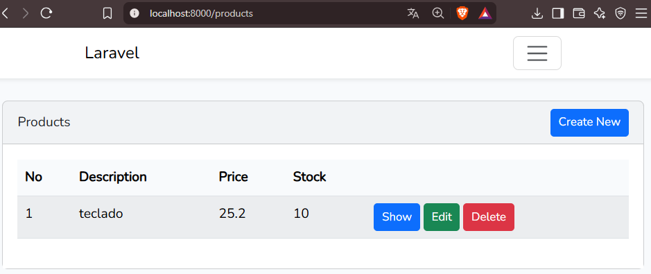
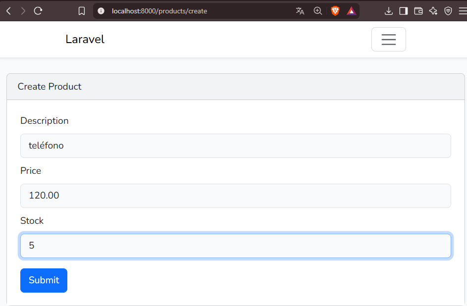
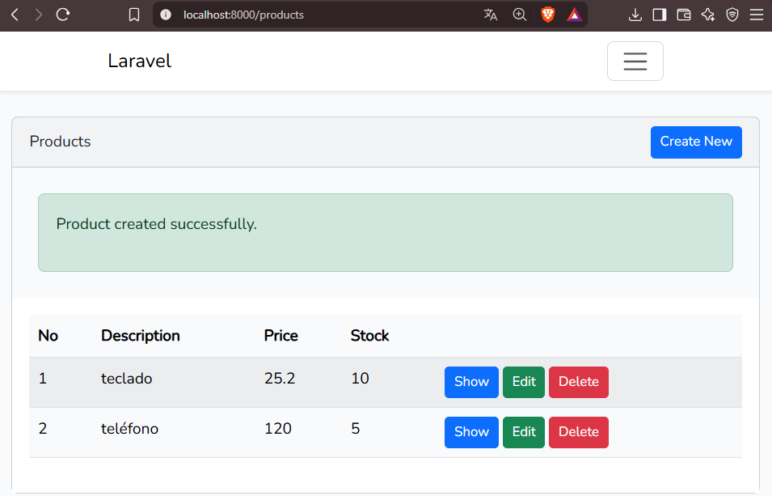
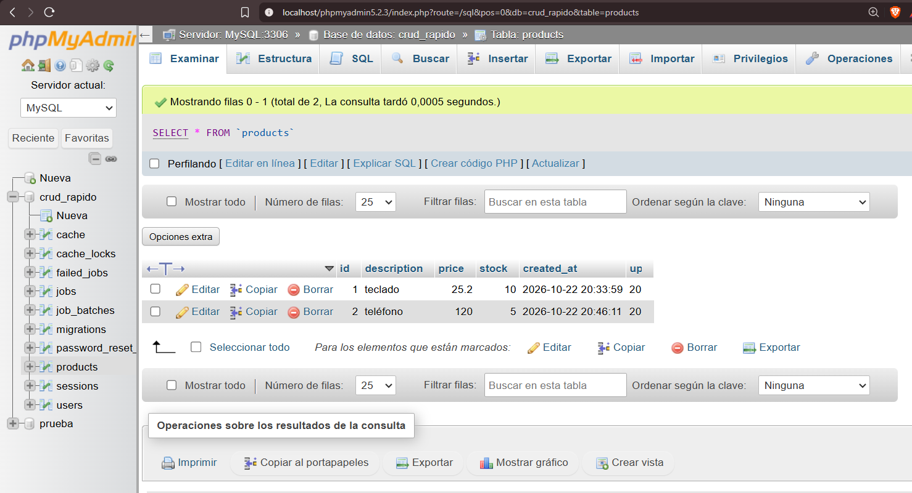

# Laboratorio #2 – CRUD rápido en Laravel (`crud_rapido`)

---

## Objetivo

Implementar un CRUD (Crear, Leer, Actualizar y Eliminar) de productos en Laravel, aplicando el patrón Modelo-Vista-Controlador (MVC), con migraciones para crear la tabla en MySQL y el paquete `ibex/crud-generator` para generar automáticamente controlador, modelo, request, vistas y rutas.

---

## Requisitos Previos

| Tecnología | Versión / Detalle |
|---|---|
|  **PHP** | 8.3.28 (Laravel 13 requiere 8.3 o superior) |
|  **Composer** | Última versión estable |
|  **Laravel** | 13.x (proyecto creado con `composer create-project` / `laravel new`) |
|  **WampServer** | 3.4.0 64-bit, entorno de desarrollo local |
|  **Apache** | 2.4.65, servidor web de WAMP |
|  **MySQL** | 8.4.7, base de datos funcionando (phpMyAdmin 5.2.3) |
|  **Visual Studio Code** | Editor de código recomendado |
|  **Node.js / npm** | 24.21.0 / 11.19.0, necesario para compilar los assets con Vite |
|  **Bootstrap** | 5, interfaz de las vistas (vía `laravel/ui`) |
|  **Windows** | Sistema operativo |

---

## Introducción: Arquitectura MVC en Laravel

| Carpeta / Archivo | Función | En este laboratorio |
|---|---|---|
| `app/Models` | **Modelo**: representa una tabla y se comunica con la base de datos | `Product.php` |
| `resources/views` | **Vista**: interfaz de usuario con plantillas Blade | `product/index`, `create`, `edit`, `show`, `form` y `layouts/app` |
| `app/Http/Controllers` | **Controlador**: recibe las peticiones y coordina modelo y vista | `ProductController.php` |
| `app/Http/Requests` | Validación de los datos del formulario | `ProductRequest.php` |
| `routes/web.php` | Define las rutas de la aplicación | `Route::resource('products', ...)` |
| `database/migrations` | Estructura de la base de datos en código PHP | `create_products_table.php` |

Flujo de una petición:

```
Navegador -> routes/web.php -> ProductController -> Modelo Product -> MySQL (tabla products)
                                       |
                                       v
                             Vista Blade (product/index) -> Navegador
```

### Comandos de migraciones utilizados

| Comando | Qué hace |
|---|---|
| `php artisan migrate` | Ejecuta las migraciones pendientes |
| `php artisan migrate:fresh` | Elimina todas las tablas y ejecuta todas las migraciones desde cero |
| `php artisan config:clear` | Limpia la configuración en caché para leer el `.env` actualizado |

---

## Instalación y Configuración

### 1. Crear el proyecto

```
cd C:\wamp64\www
composer create-project laravel/laravel crud_rapido
cd crud_rapido
```

### 2. Activar PHP 8.3 y Node.js en la terminal

```
$env:Path = "C:\wamp64\bin\php\php8.3.28;C:\Program Files\nodejs;" + $env:Path
php -v
```

### 3. Crear la base de datos

En phpMyAdmin crear la base de datos `crud_rapido` (cotejamiento `utf8mb4_unicode_ci`).

### 4. Configurar el archivo `.env`

```
DB_CONNECTION=mysql
DB_HOST=127.0.0.1
DB_PORT=3306
DB_DATABASE=crud_rapido
DB_USERNAME=root
DB_PASSWORD=
```

### 5. Evitar errores de longitud de cadena

En `app/Providers/AppServiceProvider.php`:

```php
use Illuminate\Support\Facades\Schema;

public function boot(): void
{
    Schema::defaultStringLength(191);
}
```

En `config/database.php`, dentro del bloque `'mysql'`:

```php
'engine' => 'InnoDB',
```

### 6. Crear el modelo y la migración

```
php artisan make:model Product -m
```

En la migración `create_products_table`:

```php
Schema::create('products', function (Blueprint $table) {
    $table->id();
    $table->string('description');
    $table->double('price', 8, 2);
    $table->integer('stock');
    $table->timestamps();
});
```

Ejecutar la migración:

```
php artisan config:clear
php artisan migrate
```

### 7. Flujo para generar el CRUD

```
composer require ibex/crud-generator --dev
php artisan vendor:publish --tag=crud
composer require laravel/ui
php artisan make:crud products
```

| Comando | Función |
|---|---|
| `composer require ibex/crud-generator --dev` | Instala el paquete que genera controlador, vistas, modelo, request y rutas |
| `php artisan vendor:publish --tag=crud` | Publica el archivo de configuración `config/crud.php` |
| `composer require laravel/ui` | Paquete de scaffolding con Bootstrap, necesario para el layout `layouts.app` |
| `php artisan make:crud products` | Genera el CRUD para la tabla `products` (stack: Bootstrap) |

### 8. Registrar la ruta

En `routes/web.php`:

```php
use App\Http\Controllers\ProductController;

Route::resource('products', ProductController::class);
```

Rutas generadas (se pueden ver con `php artisan route:list`):

| Método | URL | Nombre | Acción |
|---|---|---|---|
| GET | `/products` | `products.index` | Listar |
| GET | `/products/create` | `products.create` | Formulario de creación |
| POST | `/products` | `products.store` | Guardar |
| GET | `/products/{product}` | `products.show` | Ver detalle |
| GET | `/products/{product}/edit` | `products.edit` | Formulario de edición |
| PUT/PATCH | `/products/{product}` | `products.update` | Actualizar |
| DELETE | `/products/{product}` | `products.destroy` | Eliminar |

### 9. Compilar assets

```
npm install
```

---

## Base de Datos

- **Motor:** MySQL 8.4.7 (WampServer), administrado con phpMyAdmin.
- **Base de datos:** `crud_rapido`.
- **Conexión:** definida en el archivo `.env` (host, puerto, base, usuario y contraseña). Después de editarlo se ejecuta `php artisan config:clear`.
- **Tablas generadas con `php artisan migrate`:** `users`, `cache`, `cache_locks`, `jobs`, `job_batches`, `failed_jobs`, `migrations`, `password_reset_tokens`, `sessions` y **`products`**.

Estructura de la tabla `products`:

| Columna | Tipo | Detalle |
|---|---|---|
| `id` | BIGINT UNSIGNED | Llave primaria, autoincremental |
| `description` | VARCHAR(191) | Descripción del producto |
| `price` | DOUBLE(8,2) | Precio (8 dígitos, 2 decimales) |
| `stock` | INT | Existencias |
| `created_at` / `updated_at` | TIMESTAMP | Fechas de creación y modificación |

### Respaldo (backup)

El respaldo de la base de datos se encuentra en el repositorio en:

```
database/backup/crud_rapido.sql
```

Para restaurarlo: en phpMyAdmin crear la base `crud_rapido`, ir a **Importar** y seleccionar el archivo.

---

## Ejecución del proyecto

Con WampServer en verde (MySQL activo):

```
composer run dev
```

Alternativa en dos terminales: `php artisan serve` y `npm run dev`.

Acceso: <http://127.0.0.1:8000/products>

---

## Resultado

### Lista de productos



### Formulario de creación



### Producto creado con éxito



### Registros guardados en MySQL (phpMyAdmin)



---

## Dificultades Encontradas y Soluciones

### Dificultad 1: Error `Table 'crud_rapido.products' doesn't exist`

Al abrir `/products` aparecía un error 500 porque la tabla no existía en la base de datos.

**Solución:** Ejecutar las migraciones con `php artisan migrate`.

### Dificultad 2: Error `Table 'jobs' already exists`

Un intento anterior de migración quedó a medias: la tabla `jobs` existía en MySQL pero Laravel no la tenía registrada.

**Solución:** Reiniciar la base de datos con `php artisan migrate:fresh`.

### Dificultad 3: Error `Specified key was too long; max key length is 1000 bytes`

La migración `create_jobs_table` fallaba al crear un índice, porque MySQL creaba las tablas con el motor MyISAM, que limita los índices a 1000 bytes.

**Solución:** Configurar el motor InnoDB en `config/database.php` (`'engine' => 'InnoDB'`), mantener `Schema::defaultStringLength(191)` y ejecutar `php artisan migrate:fresh`.

### Dificultad 4: La terminal usaba PHP 8.0.30 y no reconocía `npm` / `npx`

Al abrir una terminal nueva aparecía `Your Composer dependencies require a PHP version ">= 8.3.0"` y `"npx" no se reconoce como un comando`.

**Solución:** Agregar PHP 8.3 y Node.js al PATH de la terminal:

```
$env:Path = "C:\wamp64\bin\php\php8.3.28;C:\Program Files\nodejs;" + $env:Path
```

---

## Referencias

- [Documentación oficial de Laravel 12.x](https://laravel.com/docs/12.x)
- [ibex/crud-generator (Laravel CRUD Generator)](https://github.com/awais-vteams/laravel-crud-generator)
- [Laravel/UI](https://github.com/laravel/ui)
- [Bootstrap](https://getbootstrap.com/docs/5.3/)
- Guía de Laboratorio #2 "Acercamiento a un CRUD rápido en Laravel", Ing. Irina Fong, UTP.

---

## Fecha de Ejecución

22 de octubre de 2026

---

Este laboratorio ha sido desarrollado por el estudiante de la **Universidad Tecnológica de Panamá**:

- **Nombre:** Irving Cruz
- **Curso:** Desarrollo Web
- **Instructor del Laboratorio:** Irina Fong